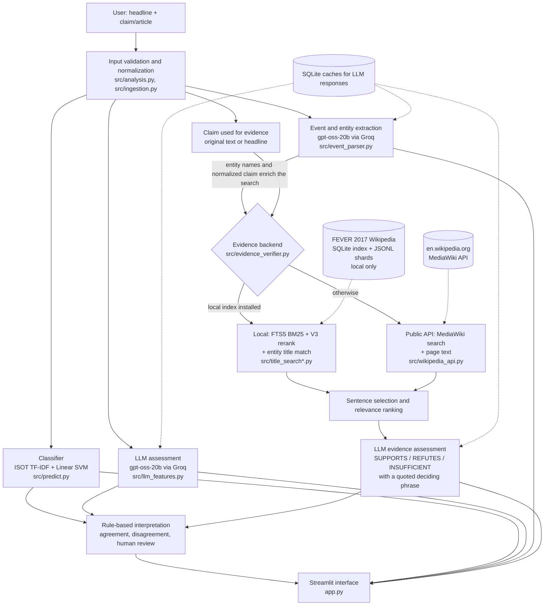

# EvidenceAware (EAFND) — Evidence-Aware Fake News Detection

EvidenceAware is a research prototype that analyses a news claim or article with four
**separate** signals and explains how they relate:

1. a **classifier prediction** from a TF-IDF + Linear SVM model trained on the ISOT fake news dataset;
2. an **LLM assessment** of the text (plausibility, verifiability, source attribution) from
   `openai/gpt-oss-20b` via the Groq API;
3. **event and entity extraction** (who / what / when / where / attribution) by the same LLM;
4. **evidence retrieval and assessment**: sentences retrieved from Wikipedia (the live public
   MediaWiki API, or a local index of the FEVER 2017 snapshot when it is installed), each
   labelled SUPPORTS / REFUTES / INSUFFICIENT by the LLM.

A rule-based interpretation then reports whether these signals agree, disagree, or are
insufficient, and when human review is recommended. **It is not a fact-checking verdict.**
No combined "truth score" is computed, and the LLM never overrides the trained classifier.

---

## Contents

1. [Problem statement](#1-problem-statement)
2. [Objectives](#2-objectives)
3. [Architecture](#3-architecture)
4. [Workflow of one analysis](#4-workflow-of-one-analysis)
5. [Datasets](#5-datasets)
6. [Preprocessing and label mapping](#6-preprocessing-and-label-mapping)
7. [Classical models and TF-IDF](#7-classical-models-and-tf-idf)
8. [XGBoost fusion (experimental, not used in the app)](#8-xgboost-fusion-experimental-not-used-in-the-app)
9. [LLM integration (Groq)](#9-llm-integration-groq)
10. [Event extraction](#10-event-extraction)
11. [Wikipedia evidence retrieval](#11-wikipedia-evidence-retrieval)
12. [Evidence assessment and interpretation](#12-evidence-assessment-and-interpretation)
13. [Results](#13-results)
14. [Installation and running locally](#14-installation-and-running-locally)
15. [Environment variables](#15-environment-variables)
16. [Deployment (Streamlit Community Cloud)](#16-deployment-streamlit-community-cloud)
17. [Testing](#17-testing)
18. [Folder structure](#18-folder-structure)
19. [Limitations](#19-limitations)
20. [Future work](#20-future-work)

---

## 1. Problem statement

Traditional fake news classifiers learn linguistic patterns from their training data. They can
be confidently wrong when the writing style changes, when the topic is unfamiliar, or when a
claim can only be judged with external facts. This repository shows the problem directly: the
ISOT classifier reaches 99% test accuracy, but much of that comes from a dataset artefact (the
Reuters dateline). It labels true one-sentence claims as FAKE with high probability (see
[Results](#13-results)).

EvidenceAware therefore puts the classifier next to evidence retrieved from an external
knowledge source and next to an LLM's reading of the text. Each signal is shown separately, so
a user can see when they disagree.

## 2. Objectives

- Classify an article as FAKE or REAL with a trained classical model and report its probabilities and provenance.
- Add an LLM-based structured assessment without letting it silently replace the classifier.
- Extract events and entities so that the claim's structure is visible and retrieval can use entity names.
- Retrieve candidate Wikipedia evidence and assess each sentence as supporting, refuting or insufficient.
- Produce a cautious, interpretable summary that flags disagreement and recommends human review.
- Degrade gracefully: the classifier must keep working when the LLM API or the evidence index is unavailable.

## 3. Architecture



The LLM assessment and event extraction run in parallel. Evidence retrieval runs after them
because it uses the extracted entity names. The backend is chosen automatically: the local FEVER
index if it exists, otherwise the public Wikipedia API (see §11).

## 4. Workflow of one analysis

| Step | What happens | Module |
|---|---|---|
| 1. Validation | Unicode/whitespace normalization; rejects empty input, fewer than 4 words or 20 characters, input with no readable words, bodies over 20,000 characters and headlines over 400 characters. The headline is prepended to the body unless the body already starts with it. | `src/analysis.py`, `src/ingestion.py` |
| 2. Classification | The full text goes through the saved ISOT TF-IDF vectorizer and all three saved ISOT classifiers. The Linear SVM is the primary model; the others are shown as an agreement check. The app flags short inputs and Reuters datelines. | `src/predict.py` |
| 3. LLM assessment | First 3,500 characters sent to `gpt-oss-20b`; returns verdict (real/fake/uncertain), plausibility, verifiability, source credibility and a rationale. Validated and cached. | `src/llm_features.py` |
| 4. Event extraction | First 6,000 characters sent to `gpt-oss-20b`; returns event summary, entities (name/type/role), time, location, attribution, normalized claim and uncertainties. Validated and cached. | `src/event_parser.py` |
| 5. Evidence retrieval | The *claim used for evidence* is the original text if it has 60 words or fewer, otherwise the headline (or the opening sentences). Backend: local FEVER index if installed, otherwise the public MediaWiki API. Extracted entity names and the normalized claim only add search queries; the original claim is always the first query. | `src/evidence_verifier.py`, `src/wikipedia_api.py`, `src/title_search_v3.py` |
| 6. Evidence assessment | A handful of relevant sentences (at most 12 from the API, up to 3 per page from the local index; at most 6 pages) go to the LLM, which labels each against the **original** claim and must quote the deciding phrase for SUPPORTS/REFUTES. Labels for sentences that were not retrieved are discarded; decisive labels whose quote is not in the sentence are downgraded to INSUFFICIENT. | `src/evidence_verifier.py` |
| 7. Interpretation | Rules combine the classifier class and the evidence direction (see §12). | `src/analysis.py` |
| 8. Display | Eight sections: classification, probabilities, submitted text, events, LLM assessment, evidence, interpretation, technical details. | `app.py` |

The original text is never replaced. The LLM's `normalized_claim` is displayed and may add one
extra search query, but it is **not** the claim that evidence is assessed against, because
normalization can drop details that matter.

## 5. Datasets

The three datasets have **different purposes**. Their metrics must not be merged.

| Dataset | Content | Labels | Used for | Location (not in Git) |
|---|---|---|---|---|
| **ISOT Fake News** | ~44.9k news articles (mostly 2016–2017). Real articles are Reuters; fake ones come from sites flagged by PolitiFact/Wikipedia. Fields: title, text, subject, date. | real / fake | Training and testing the classifier used in the app | `data/raw/isot/True.csv`, `Fake.csv` |
| **LIAR** | 12.8k short political statements from PolitiFact with speaker metadata | 6 truthfulness levels, mapped to binary | Testing how the same approach behaves on short claims | `data/raw/liar/{train,valid,test}.tsv` |
| **FEVER** | 185k claims generated from Wikipedia, plus the 2017 Wikipedia dump (~5.4M pages) | SUPPORTS / REFUTES / NOT ENOUGH INFO with gold evidence sentences | Evaluating evidence retrieval; corpus for the app's evidence step | `data/raw/fever/paper_dev.jsonl`, `data/raw/fever/wiki-pages/` |

## 6. Preprocessing and label mapping

Implemented in `src/data.py` (seed 42):

- **ISOT**: random sample of 5,000 real + 5,000 fake articles. Text = `title + ". " + text`.
  Exact duplicate texts are removed (9,699 remain). Stratified split 70/15/15 → 6,789 train /
  1,455 validation / 1,455 test. Label **0 = REAL, 1 = FAKE**.
- **LIAR**: official train/valid/test files. `true`, `mostly-true` → **0 (REAL)**;
  `half-true`, `barely-true`, `false`, `pants-fire` → **1 (FAKE)**. This binary mapping is an
  operational choice: it puts "half-true" in the fake class, which makes FAKE the majority class
  (64% of the test set). After deduplication: 10,252 / 1,284 / 1,283.
- **FEVER**: `src/fever_loader.py` streams JSONL and normalizes labels to
  `supports / refutes / not_enough_info`, keeping gold evidence as (page, sentence_id).

The app uses the same 0 = REAL / 1 = FAKE mapping. `src/predict.py` checks that every loaded
model has `classes_ == [0, 1]`, and a unit test confirms that probability index 1 is shown as FAKE.

## 7. Classical models and TF-IDF

**TF-IDF** (term frequency × inverse document frequency) turns a document into a sparse vector.
Each dimension is a word or word pair (unigram or bigram). A term gets a high weight when it is
frequent in this document but rare across the corpus. Settings (`src/classical.py`):
`ngram_range=(1,2)`, `max_features=150000`, `min_df=2`, `sublinear_tf=True`,
`strip_accents="unicode"`, English stop words removed. The vectorizer is fitted on the training
split only.

Three classifiers are trained on the TF-IDF features of each dataset:

| Model | Configuration | Notes |
|---|---|---|
| Logistic Regression | `C=2.0`, `class_weight="balanced"`, `max_iter=1500` | Linear, directly interpretable coefficients |
| Linear SVM | `LinearSVC(C=1.0, class_weight="balanced")` wrapped in `CalibratedClassifierCV(cv=3)` | Calibration gives probabilities; **primary model in the app** (best ISOT test accuracy) |
| Random Forest | 250 trees, `min_samples_leaf=2`, `class_weight="balanced_subsample"` | Non-linear baseline |

Saved artefacts are in `models/classical/` (`{dataset}_tfidf.joblib`, `{dataset}_{model}.joblib`,
and test-set probabilities `*_test_proba.npy`). Retrain with `python -m src.classical --dataset isot`.
This **overwrites** the saved models, so only do it on purpose.

## 8. XGBoost fusion (experimental, not used in the app)

`src/fusion.py` implements a late-fusion (stacking) experiment:

- Three base classifiers (as above, with a separate 100k-feature TF-IDF) are trained on the
  training split. Their FAKE probabilities on the validation and test splits become features.
- Six LLM features are appended: verdict score (real 0, fake 1, uncertain 0.5), plausibility,
  verifiability, source credibility, an "uncertain" flag and a "success" flag.
- An `XGBClassifier` (250 trees, depth 3, learning rate 0.04) is trained on the **validation**
  split features and evaluated on the test split.

**Why it is not in the production app:**

1. **Only 10 rows per split received real LLM features** (`results/metadata.json`,
   `llm_valid_rows: 10`, `llm_test_rows: 10`). All other rows had constant placeholder LLM values.
   The recorded hybrid scores therefore mostly measure stacking of the classical models, not
   LLM fusion.
2. The saved `models/fusion/*_hybrid.joblib` files contain the XGBoost meta-model and its TF-IDF,
   **but not the three base classifiers it was trained on**. Those were trained inside
   `fusion.py` and never saved, so the 9-feature input cannot be reproduced at inference time.
   Substituting the separately trained models from `models/classical/` would feed it a
   different feature distribution.

The app therefore uses the best validated classical model and shows the LLM assessment as a
separate panel. A proper hybrid evaluation needs LLM features for the full validation and test
splits and a saved, end-to-end inference bundle (see [Future work](#20-future-work)).

## 9. LLM integration (Groq)

- Model: **`openai/gpt-oss-20b`**, an open-weight model **used through the Groq inference API**.
  It was not trained or fine-tuned by this project.
- Client: Python `groq` SDK, created in `src/llm_client.py` with a 45-second timeout and one retry.
- Prompts ask for JSON only (`response_format={"type": "json_object"}`, temperature 0).
  Responses are parsed with `parse_json_object` and validated against a strict schema. Invalid,
  empty or malformed responses are rejected, never displayed as results.
- **Caching**: validated responses are stored in SQLite under `data/processed/`
  (`llm_features.sqlite`, `event_parse_cache.sqlite`, `evidence_verification_cache.sqlite`),
  keyed by a SHA-256 of model + input. Repeated submissions do not call the API again.
  Connections use a lock timeout and are always closed. Cache failures are logged and ignored.
- **Secrets**: the API key is read only from the `GROQ_API_KEY` environment variable (or a local,
  git-ignored `.env`, or Streamlit secrets). It is never logged or rendered. Error messages shown
  to users are fixed strings chosen by error type (e.g. "rate limit reached") and never include
  the raw exception text.
- **Failure behaviour**: if the key is missing or the API fails, the LLM panels show
  "unavailable" with the reason, evidence sentences are still retrieved but marked *not
  assessed*, and the classifier result is unaffected.

## 10. Event extraction

`src/event_parser.py` asks the LLM to extract, using only what the text states:

| Field | Meaning |
|---|---|
| `event_summary` | One-sentence summary of the event |
| `entities` | List of `{name, type, role}` (people, organisations, places, …) |
| `time`, `location`, `attribution` | As stated in the text, or null |
| `normalized_claim` | A simplified restatement, for display only |
| `uncertainties` | Ambiguities or missing context noted by the extractor |

Entity names are used as extra retrieval queries (exact Wikipedia title matches). The
normalized claim is not used for retrieval or assessment. An earlier experiment
(`results/event_retrieval_comparison.json`, 100 FEVER claims) found that replacing the claim with
the normalized claim did not improve retrieval: Recall@10 was 0.81 for the original vs 0.80 for
the normalized claim.

## 11. Wikipedia evidence retrieval

Two interchangeable backends feed the same assessment step (`src/evidence_verifier.py`). The
choice is automatic and can be forced with `EAFND_EVIDENCE_BACKEND` (`auto` | `local` |
`wikipedia_api` | `off`):

| Mode | When | Corpus | Where it runs |
|---|---|---|---|
| `local_index` | `data/processed/wiki_pages.sqlite` and its shards exist | FEVER 2017 Wikipedia snapshot (5.4M pages) | Your machine |
| `wikipedia_api` | The local index is missing (e.g. Streamlit Cloud), or forced | Current English Wikipedia via the public MediaWiki API | Anywhere with internet |

If the local index fails at runtime, `auto` falls back to the API and says so. If neither backend
works, the evidence section states that retrieval did not run and why; the classifier and LLM
sections are unaffected, and nothing is presented as verified.

### 11.1 Public Wikipedia API backend (`src/wikipedia_api.py`)

Standard library only (`urllib`); free, no account or key. For one claim:

1. **Queries** (at most 4): the original claim first, then up to two extracted entity names
   (dates and numbers are skipped; if the LLM is unavailable, runs of capitalized words in the claim are
   used), then the normalized claim if it differs. These queries enrich the search; they never
   replace the claim.
2. **Search + intro text**: one `action=query&generator=search` request per query (5 results for the
   claim, 3 for entities) returns page titles, intro extracts and URLs together. Disambiguation pages are
   skipped; the rankings of all queries are fused (reciprocal rank, with a bonus for an exact entity
   title match). At most 6 pages are kept.
3. **Article text**: for the top 2 pages the plain-text article is fetched (truncated to 20,000
   characters locally); other pages contribute their intro only.
4. **Sentences**: text is split into sentences (abbreviations such as "U.S." and "Dr." are handled),
   headings and fragments are dropped, and exact or near-duplicate sentences are removed.
5. **Ranking**: each sentence gets a relevance score, the IDF-weighted share of the claim's content words
   it contains (page-title words count half, because Wikipedia sentences often say "he" or "it").
   If the claim has entity names, a sentence that is not about any of them keeps only half its
   relevance. Sentences below a threshold are discarded, so unrelated text is never sent to the
   LLM. At most 12 sentences (4 per page) are assessed.

Request hygiene: descriptive `User-Agent` (override with `WIKIPEDIA_USER_AGENT`), 8-second
timeout, one bounded retry on HTTP 429/503, requests made one at a time, at most about six per
claim (typically 4 searches and 2 article fetches), and an in-process cache (1 hour, 256
entries) so repeated claims cost no requests. Rate limits, network errors, bad responses and
empty search results produce a readable status message, never a crash.

Because it reads Wikipedia's *current* text, results can differ from the FEVER snapshot, can be
affected by recent edits or vandalism, and are not independently verified.

### 11.2 Local FEVER index backend

**Index building (one-off, local):**

1. `python -m src.build_wiki_index` scans the 109 FEVER Wikipedia JSONL shards
   (~7.1 GB) and stores `(page_id, shard_path, byte_offset)` for 5,416,536 pages in
   `data/processed/wiki_pages.sqlite`.
2. `python -m src.build_title_index` adds an SQLite **FTS5** full-text table over page titles.
   With both steps the index is ~1.1 GB. Page text is read from the shards by byte offset, so
   the shards must stay in place.

**Retrieval (`src/title_search.py`, `src/title_search_v3.py`):**

- *Baseline*: content words of the claim are OR-ed into an FTS5 query and ranked by BM25.
- *V3 rerank*: takes the top 50 BM25 candidates and reranks them with
  0.65 × reciprocal BM25 rank + 0.25 × IDF-weighted claim-term coverage of the title
  + 0.10 × contiguous phrase match.
- *App*: exact title matches for extracted entity names come first, followed by V3 results for
  the claim text, up to 6 pages.

**Sentence selection:** the lead sentence of each page, plus the sentences sharing the most
content words with the claim (up to 3 per page). FEVER tokenisation artefacts (`-LRB-`, ` 's`)
are cleaned for display. The Recall@K figures in §13.4 were measured for this backend only.

## 12. Evidence assessment and interpretation

The LLM receives the **original claim** and the selected sentences (each with its Wikipedia page
title, so that pronouns can be resolved) and must label each one:

- **SUPPORTS**: the sentence itself states or directly entails the claim's key facts;
- **REFUTES**: the sentence itself states something that cannot be true if the claim is true, about
  the same entity and attribute (a different number, ordinal, date, place or person, or an explicit
  negation);
- **INSUFFICIENT**: everything else, including related background, a different entity or attribute,
  and sentences that only share names or topic with the claim.

The prompt (`VERIFIER_PROMPT`, version `v2`) forbids outside knowledge, says related or irrelevant
is *not* contradiction, and asks for a short explanation grounded in the sentence. For SUPPORTS and
REFUTES the model must also return `evidence_span`, an exact quotation from the sentence. The
response is JSON and is validated: labels for sentences that were not sent are discarded, and a
decisive label whose quotation is missing or is not actually in the sentence is downgraded to
INSUFFICIENT and flagged. The interface shows the retrieved sentence and the LLM's assessment as
separate parts of each evidence card. Labels are **LLM assessments of retrieved text, not
ground truth**. The evidence direction is: *conflicting* if there is at least one SUPPORTS and
at least one REFUTES; otherwise *refuted* or *supported* if either is present; otherwise
*insufficient*.

The interpretation combines that direction with the classifier class:

| Classifier | Evidence | Reported as |
|---|---|---|
| FAKE | refuted | "Classifier predicts FAKE and retrieved evidence contradicts the claim" |
| REAL | supported | "Classifier predicts REAL and retrieved evidence supports the claim" |
| REAL | refuted / FAKE + supported | **Disagreement**, human review strongly recommended |
| any | conflicting | Conflicting evidence, human review strongly recommended |
| any | insufficient / none found | "Classifier predicts X; retrieved evidence is insufficient" |
| any | no backend available / retrieval failed | "Classifier predicts X; evidence was not checked" |

Human review is also recommended when the classifier probability is below 65%, when the three
classifiers disagree, when the input is short (< 50 words), when the text has a Reuters dateline,
or when the LLM verdict is uncertain or differs from the classifier. The LLM verdict is reported
as agreeing or differing. It never changes the classifier's prediction.

## 13. Results

All numbers come from files in `results/`. ISOT, LIAR and FEVER measure different things and
are reported separately.

### 13.1 ISOT (held-out test split, 1,455 articles: 748 real, 707 fake)

Source: `results/isot_classical.json`. The saved models were re-checked with
`results/saved_model_evaluation.json` and reproduce these numbers exactly.

| Model | Accuracy | Precision (FAKE) | Recall (FAKE) | F1 (FAKE) | Macro-F1 | Confusion matrix [[TN, FP], [FN, TP]] |
|---|---:|---:|---:|---:|---:|---|
| Logistic Regression | 97.87% | 98.01% | 97.60% | 97.80% | 97.87% | [[734, 14], [17, 690]] |
| **Linear SVM** | **99.04%** | 99.01% | 99.01% | 99.01% | 99.04% | [[741, 7], [7, 700]] |
| Random Forest | 97.66% | 98.28% | 96.89% | 97.58% | 97.66% | [[736, 12], [22, 685]] |

Majority-class baseline: 51.4%. Per-class F1 for REAL and FAKE is within 0.2 points for every model.

**Why the ISOT score is not real-world accuracy (shortcut analysis, `results/saved_model_evaluation.json`):**

- 99.9% of REAL test articles contain the word "Reuters" and 2.0% of FAKE ones do. The
  strongest REAL-indicative terms of the Logistic Regression are `reuters`, `said`,
  `washington reuters`, and weekday names. The strongest FAKE-indicative terms include
  `pic twitter`, `featured image`, `getty images`, `watch` and `video`. The models learn
  publisher style.
- Removing "Reuters" from the text only lowers accuracy a little (SVM 98.0%, LR 97.2%), so other
  stylistic cues remain.
- With **titles only**, accuracy falls to **69.1% (SVM)**, 79.2% (LR) and 49.6% (RF). Short
  claims, which users often paste, are far outside the training distribution.
- The first 25 words are enough for 99.5% (SVM), because they include the dateline.

### 13.2 LIAR (official test split, 1,283 statements: 460 real, 823 fake after mapping)

Source: `results/liar_classical.json` (reproduced in `saved_model_evaluation.json`).

| Model | Accuracy | Precision (FAKE) | Recall (FAKE) | F1 (FAKE) | Macro-F1 | F1 (REAL) | Confusion matrix |
|---|---:|---:|---:|---:|---:|---:|---|
| Logistic Regression | 61.03% | 71.85% | 64.52% | 67.99% | 59.09% | 50.2% | [[252, 208], [292, 531]] |
| Linear SVM | 64.54% | 64.77% | 98.06% | 78.01% | 43.23% | 8.5% | [[21, 439], [16, 807]] |
| Random Forest | 61.11% | 69.66% | 69.74% | 69.70% | 57.70% | 45.7% | [[210, 250], [249, 574]] |

Majority-class baseline (always FAKE): **64.1%**. The Linear SVM's 64.5% is essentially the
baseline: it predicts FAKE for 97% of statements. Logistic Regression and Random Forest have
lower accuracy but are more balanced (higher macro-F1). Short political claims cannot be judged
reliably from wording alone.

### 13.3 Hybrid XGBoost fusion (limited experiment)

Source: `results/isot_hybrid.json`, `results/liar_hybrid.json`, `results/metadata.json`.

| Dataset | Accuracy | Precision | Recall | F1 | ROC-AUC | Rows with real LLM features |
|---|---:|---:|---:|---:|---:|---|
| ISOT | 99.18% | 99.01% | 99.29% | 99.15% | 0.9992 | 10 of 1,455 valid, 10 of 1,455 test |
| LIAR | 63.45% | 66.27% | 87.61% | 75.46% | 0.5955 | 10 of 1,284 valid, 10 of 1,283 test |

These runs **do not** evaluate LLM fusion: 99% of rows had placeholder LLM values. See §8.

### 13.4 FEVER evidence retrieval (paper_dev, first 1,000 SUPPORTS/REFUTES claims)

| Measurement | Value | What it measures | Source |
|---|---:|---|---|
| Title retrieval Recall@1 / @5 / @10 (BM25 baseline) | 56.4% / 79.0% / 82.4% | A gold page is among the top-K retrieved titles | `results/fever_title_retrieval.json` (re-run 2026-11-17) |
| Title retrieval Recall@1 / @5 / @10 (V3 rerank) | 56.4% / 79.8% / 83.8% | Same, with reranking | `results/fever_title_retrieval.json` |
| Top-50 candidate coverage | 89.2% | A gold page is anywhere in the top 50 BM25 candidates | recorded earlier from console output (not re-run) |
| Gold-reference evidence recovery | 99.37% | Given the **known gold** (page, sentence ID), the index returns the sentence | `src/evaluate_evidence.py`, recorded earlier (not re-run) |

The 99.37% figure is an **oracle check of the index**, not end-to-end accuracy. It shows that the
storage works, not that the system finds the right evidence. (Earlier notes give baseline
Recall@1 as 56.5%; the re-run gives 56.4%, probably due to BM25 tie ordering.) End-to-end
SUPPORTS/REFUTES accuracy of the LLM evidence assessment on FEVER has **not** been measured yet.

### 13.5 Illustrative end-to-end runs (not an evaluation)

`results/end_to_end_examples.json` holds one run of each built-in example in the app, using the
local FEVER backend and the current (v2) evidence prompt:

| Example | Classifier | Evidence (S/R/I) | Interpretation |
|---|---|---|---|
| "Telemundo is an English-language television network." | FAKE 72.8% | 0 / 1 / 15 | FAKE, evidence contradicts |
| "Fox 2000 Pictures released the film Soul Food." | FAKE 99.6% | 1 / 0 / 15 | **Disagreement** (true claim, classifier wrong) |
| Local council bike-lane budget | REAL 65.7% | 0 / 0 / 14 | Evidence insufficient |
| Apollo 11 news-style article | REAL 70.6% | 0 / 0 / 14 | Evidence insufficient |
| "Kitchen spice cures cancer" viral claim | FAKE 62.8% | 0 / 0 / 13 | Evidence insufficient |

The Soul Food case shows why the classifier must not be presented as a truth detector.

### 13.6 Public Wikipedia API backend: spot checks (not an evaluation)

`results/wikipedia_api_check.json` records real runs (live MediaWiki requests plus Groq) with the
local index absent, as on Streamlit Cloud. For the claim *"The first inauguration of Bill Clinton made
him the 50th President of the United States."* the backend retrieved the Bill Clinton page and 11
other sentences; the LLM labelled two sentences REFUTES, quoting "served as the 42nd president of the
United States", and the other 10 INSUFFICIENT, including sentences about Hillary Clinton and Clinton's
family. Three more claims behaved as expected: an Einstein birthplace claim was SUPPORTED, a claim
about a local council budget returned no relevant evidence, and a claim that Marie Curie won the
Literature prize stayed INSUFFICIENT because no retrieved sentence states that she did not. These are
spot checks of the mechanism on four claims, not a measurement of accuracy. A systematic evaluation
against FEVER labels has not been run (see §20).

## 14. Installation and running locally

Requirements: Python 3.9 or newer. On 3.9–3.12 the exact training versions are installed (scikit-learn 1.6.1, numpy 2.0.2); on 3.13+ `requirements.txt` selects scikit-learn 1.7.2 / numpy 2.5.5, which were verified to reproduce the saved test-set probabilities exactly.

```bash
git clone https://github.com/BixbyCodes/fakenewd.git evidence_aware_fnd
cd evidence_aware_fnd
python3 -m venv .venv
source .venv/bin/activate
pip install -r requirements.txt          # app only
# pip install -r requirements-research.txt   # + xgboost for the training/fusion scripts

cp .env.example .env    # then put your Groq key in .env (never commit it)
                        # get a key at https://console.groq.com/
streamlit run app.py
```

Open http://localhost:8501. Without a key, the classifier still works and the LLM sections show
as unavailable.

**Evidence retrieval needs no setup**: with no local index the app uses the public Wikipedia API
(internet access required, no key). The header chip reads "Wikipedia evidence: live Wikipedia API".

**Optional: the local FEVER index** (~8.2 GB disk; reproducible research mode, offline retrieval of
the 2017 snapshot):

1. Download the FEVER Wikipedia dump (`wiki-pages.zip`) from https://fever.ai/dataset/fever.html
   and extract it so that the files are at `data/raw/fever/wiki-pages/wiki-001.jsonl … wiki-109.jsonl`.
2. `python -m src.build_wiki_index` (page offsets), then `python -m src.build_title_index` (FTS5 titles).
3. Restart the app. The chip should now read "local FEVER index". The local index takes priority
   in `auto` mode; set `EAFND_EVIDENCE_BACKEND=wikipedia_api` to use live Wikipedia instead.

To keep the data elsewhere, set `EAFND_WIKI_INDEX` (path to `wiki_pages.sqlite`) and
`EAFND_WIKI_PAGES_DIR` (folder with the shards).

**Command-line tools:**

```bash
python -m src.predict --text "Article text …"     # classifier only
python -m src.evaluate_saved_models               # re-evaluate saved models (no retraining)
python -m src.evaluate_title_search_v3            # FEVER retrieval Recall@K (needs index)
python -m src.pipeline --dataset isot --llm-limit 10   # FULL RETRAIN + fusion (overwrites models)
```

## 15. Environment variables

| Variable | Required | Purpose |
|---|---|---|
| `GROQ_API_KEY` | For LLM features | Groq API key. Without it, LLM assessment, event extraction and evidence *assessment* are disabled. |
| `GROQ_MODEL` | No | Defaults to `openai/gpt-oss-20b`. Changing it invalidates comparability with recorded runs. |
| `GROQ_TIMEOUT_SECONDS` | No | Per-request timeout (default 45). |
| `EAFND_WIKI_INDEX` | No | Path to `wiki_pages.sqlite` (default `data/processed/wiki_pages.sqlite`). |
| `EAFND_WIKI_PAGES_DIR` | No | Folder with the FEVER `wiki-*.jsonl` shards, if moved. |
| `EAFND_EVIDENCE_BACKEND` | No | `auto` (default: local index if present, else public API), `local`, `wikipedia_api` or `off`. |
| `WIKIPEDIA_USER_AGENT` | No | `User-Agent` for Wikipedia API requests. Defaults to `EvidenceAware/1.0 (research prototype; https://github.com/BixbyCodes/fakenewd)`; set your own contact if you fork the project. |
| `WIKIPEDIA_API_URL` | No | MediaWiki endpoint (default `https://en.wikipedia.org/w/api.php`). |

## 16. Deployment (Streamlit Community Cloud)

The app is a single Streamlit script, so Streamlit Community Cloud is the simplest host. The
deployed bundle is the Git repository (~69 MB including the trained models). The multi-GB FEVER
Wikipedia index is **not** uploaded (not suitable for Git or a free host). Instead, the public app
automatically uses the **public Wikipedia API** for evidence, so a deployment provides the classifier,
LLM assessment, event extraction **and** Wikipedia evidence with sentence-level labels and source
links, using only free services (Streamlit Community Cloud, Groq, Wikipedia). The header chip shows
"Wikipedia evidence: live Wikipedia API". If Wikipedia cannot be reached, the evidence section says so and
the rest of the analysis still works.

Steps:

1. Push this repository to GitHub (models in `models/` are tracked; `data/`, `.env` and caches are ignored).
2. Sign in at https://share.streamlit.io with GitHub → **Create app** → choose the repository,
   branch `main`, main file `app.py`.
3. **Advanced settings** → Python version: 3.11 recommended (newer versions also work, see §14).
4. **Secrets** → paste:
   ```toml
   GROQ_API_KEY = "your-key-here"
   ```
   Secrets are stored by Streamlit, not in Git. `app.py` copies them into the environment at startup.
   Optional secrets: `GROQ_MODEL`, `EAFND_EVIDENCE_BACKEND`, `WIKIPEDIA_USER_AGENT`. No Wikipedia key is needed.
5. Deploy and test the URL with the built-in examples. Streamlit redeploys on every push to `main`.

Configuration files: `requirements.txt` (pinned runtime dependencies, no extra packages for the
Wikipedia backend), `.streamlit/config.toml` (light theme, error details hidden from users, usage stats off).

Notes: anyone with the public URL shares your Groq quota and generates Wikipedia API traffic from
the app server. Evidence labels, LLM responses and Wikipedia responses are cached, which prevents repeat
calls for identical claims, and the app degrades gracefully if either service is rate-limited.

## 17. Testing

```bash
python -m unittest discover -s tests -v
```

98 tests (verified on Python 3.9, 3.11 and 3.14), none of which use the network or the real Groq API
(urllib and the LLM client are replaced with fakes; caches go to temp directories):

- `tests/test_ingestion.py`, `tests/test_fever_loader.py`, `tests/test_evidence_retriever.py`: original module tests.
- `tests/test_pipeline.py`: input validation (empty, too short, non-text, too long, headline
  handling); model loading, prediction schema and **FAKE/REAL label mapping**; missing API key;
  error messages not leaking secrets; LLM JSON parsing and schema rejection; event parser
  validation; evidence retrieval on a miniature FTS5 index; missing index / missing shard;
  LLM timeout during evidence assessment; the interpretation rules; full pipeline runs with no
  key/no index and with a rate-limited LLM; and a Streamlit `AppTest` that renders the app and
  submits valid and empty input.
- `tests/test_wikipedia_api.py`: Wikipedia search-response parsing (ranking, disambiguation and
  missing pages), page-text retrieval, sentence extraction, duplicate removal, evidence ranking,
  query building (original claim first), HTTP handling (User-Agent, timeout, 429 retry, 5xx,
  network errors, bad JSON, oversized responses, no leaked details), caching, empty search results,
  LLM evidence classification (quote grounding, downgrades, invalid items, cache keys), local-index
  and public-API backend selection and fallback, and two Streamlit `AppTest` runs that render the
  evidence cards (success) and the failure message (Wikipedia unreachable).

The public API and the Clinton example were exercised separately with real requests (§13.6).

## 18. Folder structure

```
app.py                       Streamlit interface
requirements.txt             Pinned runtime dependencies (deployment)
requirements-research.txt    + xgboost for training/fusion scripts
.streamlit/config.toml       Theme and server settings
.env.example                 Template for local secrets (.env is git-ignored)
src/
  analysis.py                End-to-end orchestration, input validation, interpretation rules
  config.py                  Paths, limits, model name
  llm_client.py              Groq client, timeouts, JSON parsing, safe errors, SQLite cache
  predict.py                 Classifier inference (ISOT Linear SVM + agreement models)
  llm_features.py            LLM text assessment; LLM features for fusion
  event_parser.py            LLM event/entity extraction
  evidence_verifier.py       Backend selection, sentence selection, LLM evidence assessment
  wikipedia_api.py           Public MediaWiki API retrieval: search, page text, sentence ranking
  title_search.py            FTS5/BM25 title search, index status, read-only connections
  title_search_v2.py, title_search_v3.py   Reranking variants (V3 used in the app)
  indexed_evidence_retriever.py, evidence_retriever.py   Page/sentence lookup
  build_wiki_index.py, build_title_index.py              One-off index builders
  ingestion.py, fever_loader.py, data.py                 Data handling
  classical.py, fusion.py, pipeline.py, train_roberta.py Training / experiments
  evaluate_*.py, analyze_*.py, inspect_fever.py          Evaluation and analysis scripts
models/
  classical/                 Saved TF-IDF vectorizers and classifiers (ISOT, LIAR)
  fusion/                    Saved XGBoost meta-models (experimental; not used by the app)
results/                     All recorded metrics (see §13)
tests/                       unittest suite
data/                        Raw datasets, processed splits, Wikipedia index, caches (git-ignored)
```

## 19. Limitations

- **Dataset shortcuts.** The ISOT classifier relies heavily on publisher style (Reuters
  datelines, Twitter/Getty boilerplate). High ISOT accuracy does not transfer to other sources
  or to short claims (titles only: 69% for the primary model).
- **Probabilities are not truth.** Calibrated SVM probabilities describe how ISOT-like the text
  is. A true claim can get 99.6% FAKE.
- **LIAR.** Binary LIAR performance is near the majority baseline. The mapping of "half-true"
  to FAKE is a choice that affects the results.
- **LLM assessments** can be wrong, can use the model's own background knowledge, and are not
  deterministic across model updates. The LLM was not trained or evaluated by this project for
  this task.
- **Evidence coverage.** Wikipedia is an encyclopedia: local news, rumours and most claims in news
  articles have no page, and then the result is INSUFFICIENT. The local backend uses a 2017
  snapshot and title-only retrieval (Recall@10 ≈ 84% on FEVER claims). The API backend relies on
  Wikipedia's search engine, which can miss the most specific page (for example, for the Clinton
  claim it did not surface the dedicated inauguration article, only the main biography page),
  and its sentence ranking is lexical, so some retrieved sentences are off-topic.
- **Live Wikipedia.** The API backend reads current article text, which can change, contain errors
  or be vandalised, and its retrieval quality has not been measured systematically. Public APIs can
  rate-limit or be unreachable; the app then reports that evidence was not checked.
- **No end-to-end evidence accuracy.** The verifier's SUPPORTS/REFUTES labels have not been
  evaluated against FEVER gold labels.
- **Hybrid model** was trained with LLM features for only 10 rows per split and cannot be run at
  inference time (base learners not saved).
- **Long articles** are verified against their headline or opening sentences, not every claim
  in the article.
- **Latency.** The API backend adds about 5–10 seconds per new claim (several Wikipedia requests and
  one LLM call); repeated claims are served from caches.

## 20. Future work

- Evaluate the LLM evidence assessment end-to-end on FEVER (label accuracy, macro-F1 by class).
- Re-run fusion with LLM features for the full validation and test splits, and save a complete
  inference bundle (vectorizer + base learners + meta-model) so it can be served.
- Reduce ISOT shortcut learning: strip datelines and boilerplate before training, test
  cross-dataset (train ISOT → test on other sources).
- Dense or hybrid (BM25 + embedding) sentence retrieval over page text, not just titles.
- Evaluate the public-API backend on FEVER claims (page Recall@K and end-to-end label accuracy) and
  compare it with the local FEVER backend.
- Dense or hybrid sentence retrieval inside the API backend, and additional free sources (e.g. Wikidata).
- Claim decomposition for long articles, verifying several check-worthy sentences.
- Per-session rate limiting for public deployments.
- Graph-based context (entity/event graphs) to link related claims and evidence.
- Systematic ablation studies of each component's contribution.

## Author

**Utsav Tripathi** · GitHub: [@BixbyCodes](https://github.com/BixbyCodes) · Repository: [BixbyCodes/fakenewd](https://github.com/BixbyCodes/fakenewd)

---

*EvidenceAware is a research prototype. Its outputs are model predictions and LLM assessments,
not fact-checking verdicts.*
